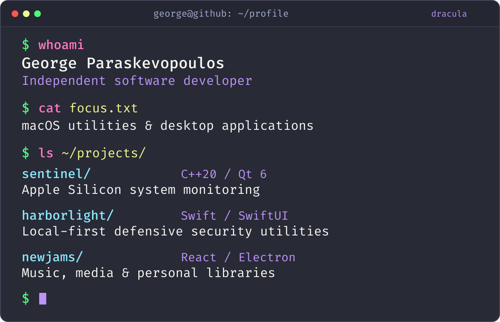

  

  <picture>
    <source media="(max-width: 767px)" srcset="assets/terminal-mobile.svg" />
    
  </picture>

  <a href="https://github.com/Unknown-George/Sentinel"><samp>~/Sentinel</samp></a> &nbsp;·&nbsp;
  <a href="https://github.com/Unknown-George/harborlight-security-toolkit"><samp>~/Harborlight</samp></a> &nbsp;·&nbsp;
  <a href="https://github.com/Unknown-George/NewJam"><samp>~/NewJams</samp></a>

  <a href="https://github.com/Unknown-George?tab=repositories"><samp>all repositories</samp></a> &nbsp;·&nbsp;
  <a href="https://newjams.pages.dev/"><samp>open NewJams</samp></a>

