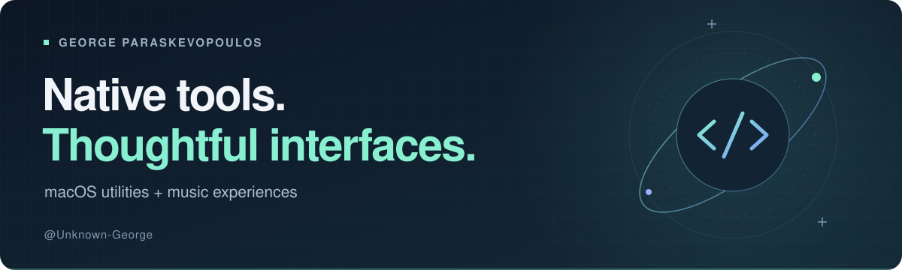

  

I'm **George**, an independent developer building native macOS tools and music experiences. My projects range from system monitoring and defensive security utilities to a music player with a little Y2K personality.

### Selected work

| Project | What I'm building | Built with |
| :--- | :--- | :--- |
| **[Sentinel](https://github.com/Unknown-George/Sentinel)** | An Apple Silicon system monitor with live metrics, local history, and a quiet dark interface. | C++20 · Qt 6 |
| **[Harborlight](https://github.com/Unknown-George/harborlight-security-toolkit)** | A local-first macOS workbench for defensive security checks and everyday utilities. | Swift · SwiftUI |
| **[NewJams](https://github.com/Unknown-George/NewJam)** | A music and media player with playlists, a personal library, and a Y2K-inspired interface. | React · Electron · JavaScript |

### At the intersection of

**Native software** &nbsp; / &nbsp; **Clear interfaces** &nbsp; / &nbsp; **Useful little details**

I like giving practical tools a distinct visual identity — from Sentinel's black cat to NewJams' playful music library.

---

[Explore my repositories](https://github.com/Unknown-George?tab=repositories) &nbsp; · &nbsp; [Try NewJams](https://newjams.pages.dev/)
