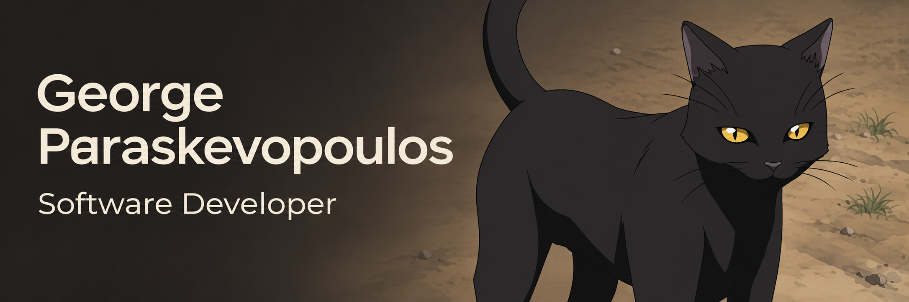

  

# George Paraskevopoulos

Independent software developer focused on macOS applications and desktop interfaces. My work includes system monitoring, defensive security utilities, and music applications.

### Selected projects

| Project | Overview | Technology |
| :--- | :--- | :--- |
| **[Sentinel](https://github.com/Unknown-George/Sentinel)** | Native Apple Silicon system monitor with live metrics and local activity history. | C++20 · Qt 6 |
| **[Harborlight](https://github.com/Unknown-George/harborlight-security-toolkit)** | Local-first macOS workbench for defensive security checks, hashing, password generation, and network calculations. | Swift · SwiftUI |
| **[NewJams](https://github.com/Unknown-George/NewJam)** | Music and media application with playlists, a personal library, and desktop support. | React · Electron · JavaScript |

[View repositories](https://github.com/Unknown-George?tab=repositories) · [Open NewJams](https://newjams.pages.dev/)
